# DECICAT

A one-touch pixel-art runner for the crypto community. Hop across candlestick charts, stomp bears, face a final boss, and ride a rocket to the moon.

**[Play it in your browser → decicat.bitcade.xyz](https://decicat.bitcade.xyz)** · free, no sign-up, works on phones and right inside X

Decicat is part of **Bitcade**, my series of browser arcade games.

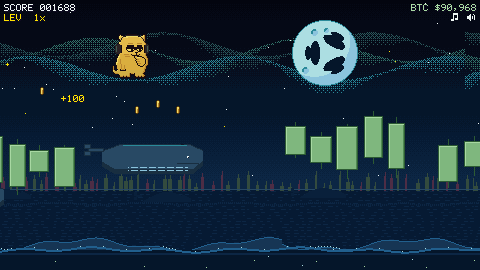

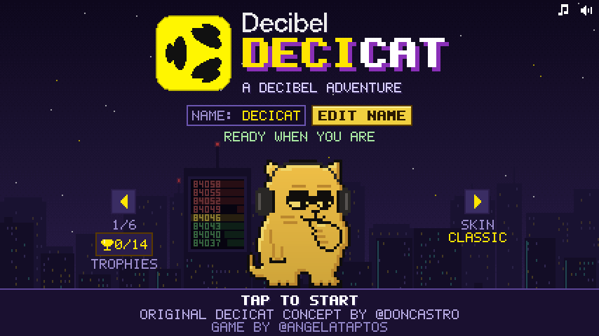

## Why I made it

I'm a community manager at the Aptos Foundation and have been in crypto since 2021. I wanted to turn crypto culture (charts, whales, flash crashes, bear markets) into something anyone can enjoy in a few seconds, and to learn what it really takes to ship a product people use. Decicat is that project: a game you can open from a post on X and play with one finger.

## Who plays it

Crypto Twitter. Decicat launched on X on **October 9, 2026**, and players found it through posts and shares, often playing right inside the X app. Many came back again and again to climb the global leaderboard.

## The numbers

*As of October 15, 2026, from the game's own anonymous player counter and the public leaderboard.*

| | |
| --- | --- |
| Unique players | **453** |
| Ranked runs on the global leaderboard | **6,027** |
| Runs in the first 2 hours after launch | **about 314** |
| Top score | **140,711** |
| Runs in the top 20 that reached the Moon | **13** |

## What's in it

- **10 hand-made stages**, each with its own scenery and hazards
- **An original soundtrack**
- **A boss fight**, then a **rocket ride to the moon**
- **Endless Moon Mode** after the ending
- **Power-ups**, a 40x rocket boost, trophies and skins
- **Global leaderboard** with exact ranks
- **A top-20 tribute video** celebrating the leaderboard's best players
- **Privacy-first**: no accounts, no cookies

## How to play

Decicat runs on its own. Your only job is to jump.

| Input | Action |
| --- | --- |
| Tap, click, Space, Up arrow, W or Enter | Jump |
| Hold the jump | Jump higher |
| Tap again in mid-air | Double jump |
| M | Mute or unmute |
| P or Esc | Pause |

Green candles are safe to stand on. Red candles hurt, but brushing past one earns a close-call bonus. Land on a bear from above to stomp it. Fall into a gap and the run is over.

## The stages

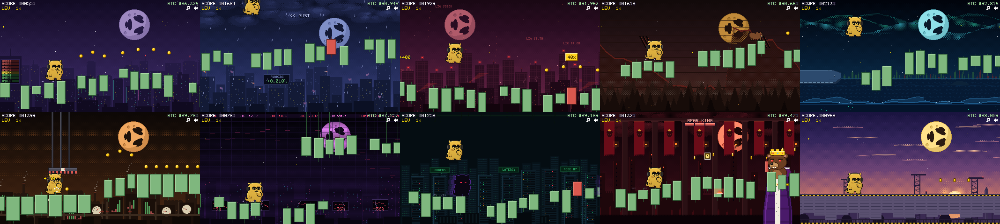

| Whale Waters | Flash Crash |
| --- | --- |
| 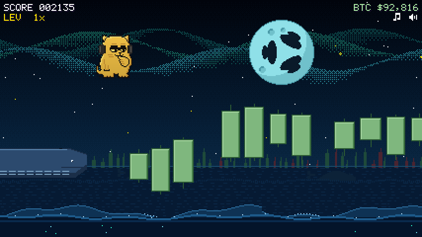 | 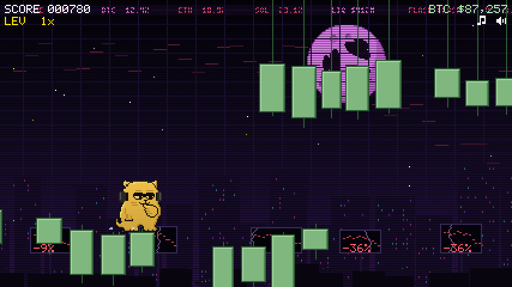 |

| Front-Runner Alley | The final boss |
| --- | --- |
| 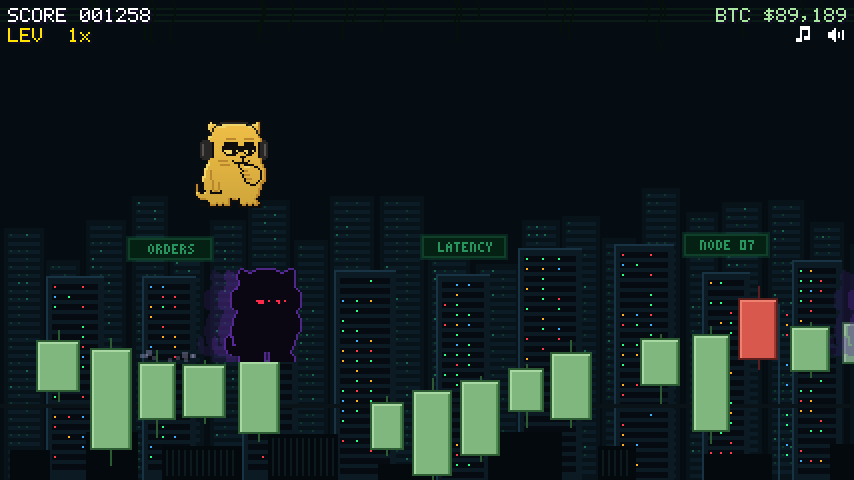 | 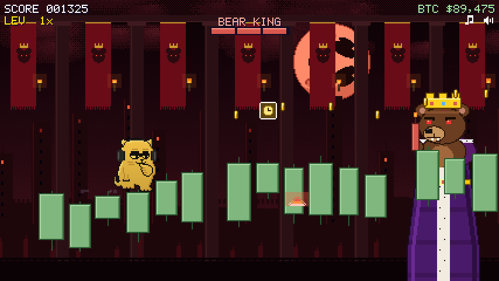 |

### The rocket ending

| Liftoff | To the moon | Landing |
| --- | --- | --- |
| 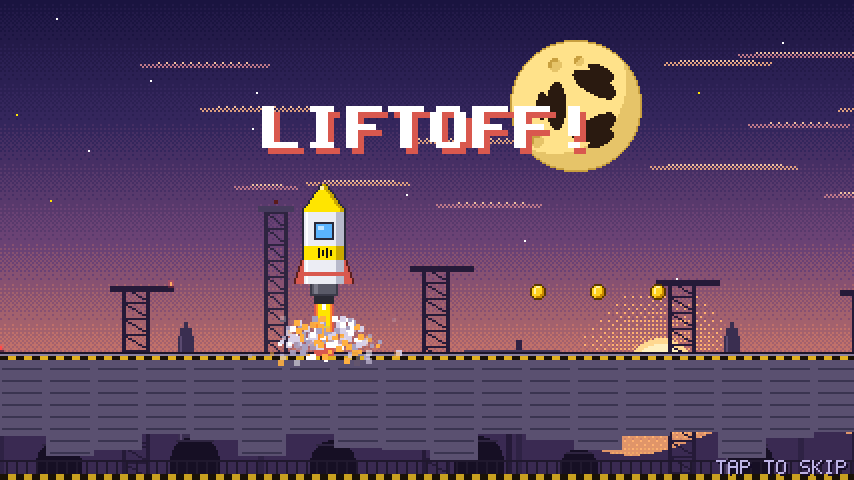 | 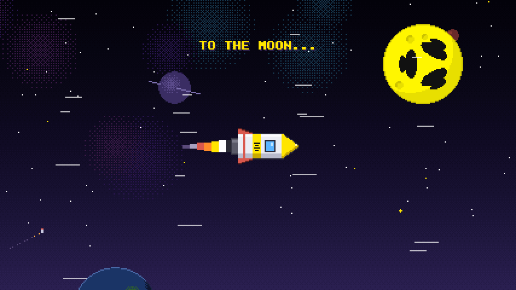 | 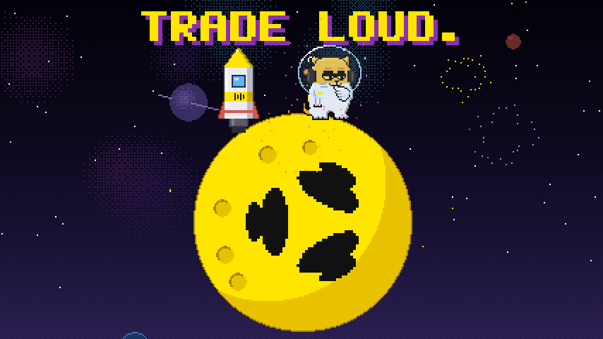 |

### Moon Mode

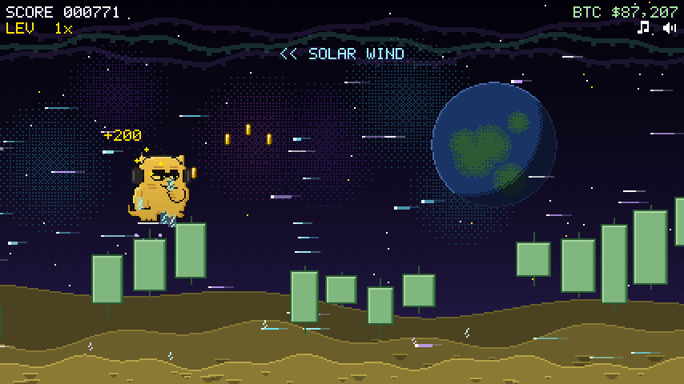

### More

| Power-ups | 40x boost | Skins |
| --- | --- | --- |
| 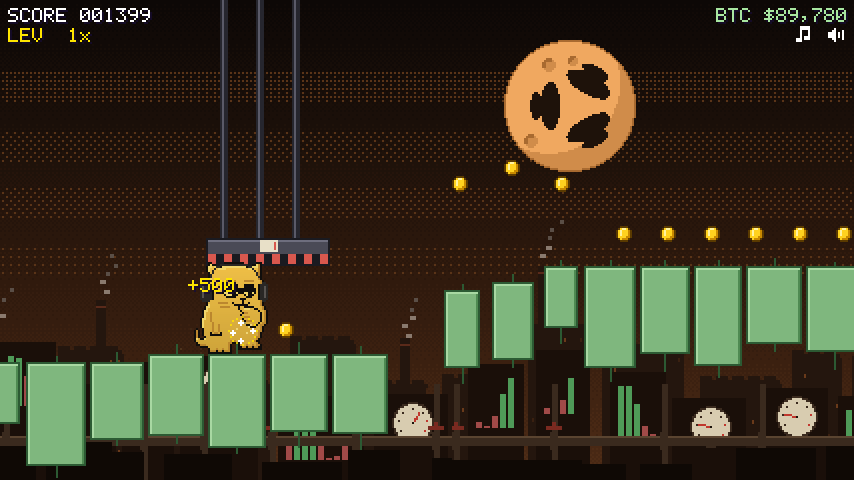 | 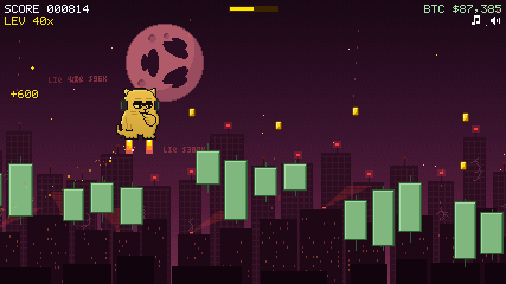 | 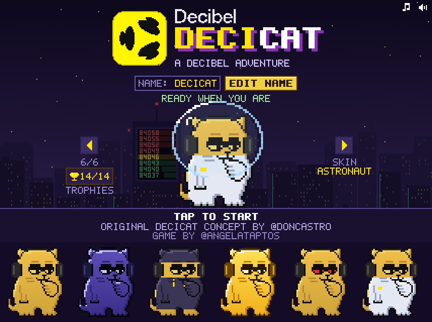 |

| Game over | Score Code |
| --- | --- |
| 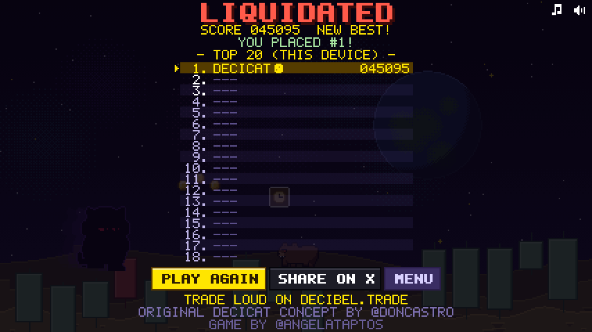 | 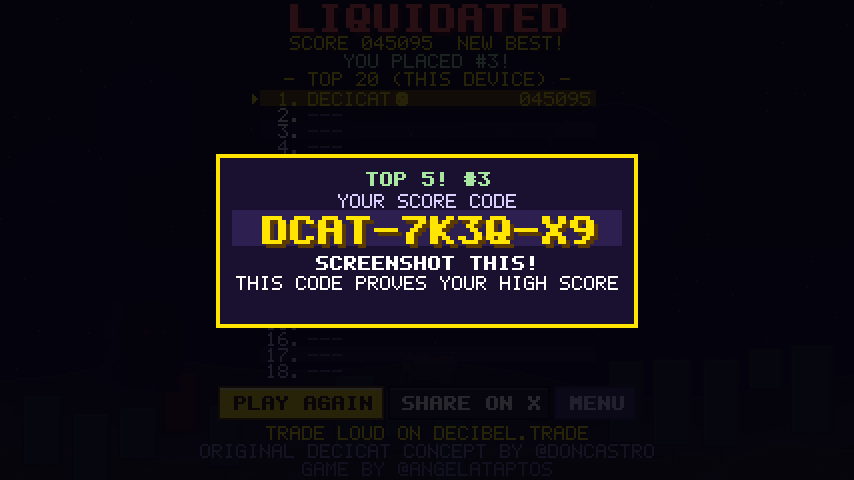 |

## Soundtrack

- [Title theme](docs/music/title_theme.mp3)
- [Stage 9: the boss](docs/music/stage9_bear_king.mp3)
- [Moon Mode](docs/music/moon_mode.mp3)

## How I built it

A browser game served from Cloudflare's edge, with a small serverless backend for the leaderboard and an anonymous, cookieless player counter. No accounts and no app store: one link that works on desktop, phones and inside X.

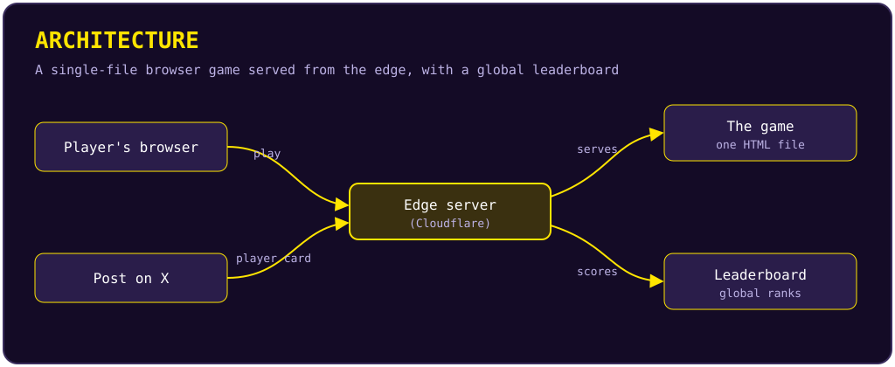

## Challenges I solved

- **Launch-day traffic.** Hundreds of runs arrived in the first hours, so the game and leaderboard had to stay fast and reliable from the start.
- **Fair, trustworthy rankings.** A public leaderboard is only fun if people trust it, so I put real care into keeping it fair.
- **One-finger fun on every screen.** Tuning jumps, difficulty and pacing so it feels good on a phone, a laptop and inside the X app.
- **Iterating live.** I shipped regular updates during launch week, based on what players told me.

## What I learned

- **Shipping on Cloudflare**: hosting, serverless functions and storage for a real, public product.
- **Building in public** with the X community: sharing progress, celebrating players and turning feedback into updates.
- **Iterating from player feedback**: small, frequent improvements beat big rewrites.
- **Data accuracy**: reporting only numbers I can verify.
- **Privacy and security basics**: collecting as little as possible and protecting what's public.

## Credits

Original Decicat concept by [@doncastro](https://x.com/doncastro)  
Game by [@angelataptos](https://x.com/angelataptos)

## License

Copyright (c) 2026 Angel Fundora. All rights reserved. Source code is private.
See [LICENSE](LICENSE).
